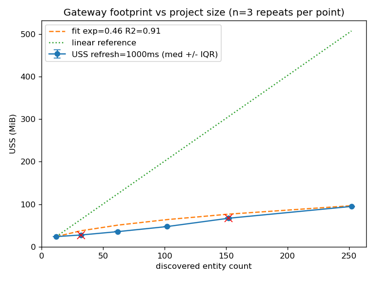

# Gateway Benchmark Harness

A benchmark for the ros2_medkit runtime: the gateway and the fault manager. It
measures their memory and CPU cost while they run against a real or synthetic ROS 2
graph, and reports the numbers with statistical confidence (repeats and spread, not a
single sample).

It answers these questions:

- How much memory and CPU do the gateway and the fault manager use, each and summed?
- How much disk does the runtime take, and how fast does it grow?
- Does it add scheduling latency to other processes on the same machine?
- How does that cost grow as the ROS 2 graph gets larger?
- Which gateway config setting costs the most?
- Does the heap grow over time (a leak), and where?

## What it measures

| Metric | Meaning |
|---|---|
| **USS** (Unique Set Size) | Private memory of the gateway process - the pages that would be freed if it exited. This is the honest per-process footprint and the primary memory metric here. |
| **PSS** (Proportional Set Size) | Private pages plus each shared page divided by the number of processes sharing it. Fairer than RSS when libraries are shared. |
| **RSS** (Resident Set Size) | All resident pages including shared libraries. Reported as an upper bound only. |
| **CPU-cores** | CPU-seconds consumed per wall-clock second. `1.0` means one core fully busy; can exceed 1 (the gateway is multi-threaded). Machine-independent. |
| **threads** | Thread count of the gateway process. |
| **heap growth** | Allocated heap over time and per-call-site, from heaptrack. |

USS, PSS and RSS are read from `/proc/<pid>/smaps_rollup`; CPU is computed from the
`utime`+`stime` counters in `/proc/<pid>/stat`.

Every lane that samples `gateway_node` also samples `fault_manager_node` with the same
metrics over the same window. Reports show the gateway, the fault manager and their
**sum** (`USS sum`, `CPU sum`, `threads sum`); `summary.json` carries them as `fm_*` and
`sum_*` keys. The steady-state gate covers both processes: a rising fault manager makes
the repeat not-steady. The fault manager is found by its command line, not by name
(`pgrep -x` cannot match names over 15 characters, and `ros2 run` puts a launcher in
front of the node); the PID and command line of each sampled process are printed in the
report and stored in `run_metadata.json` under `processes`.

The synthetic lanes start the fault manager next to the gateway at its default settings
(SQLite store). Set `BENCH_FAULT_MANAGER=0` to run the gateway alone.

## Method

The goal is numbers you can trust and compare, not a single reading.

1. **Process isolation.** Only the gateway process is sampled (resolved by name
   inside its container), never the whole stack. A footprint of "the gateway" must
   not include Gazebo or Nav2.
2. **Warm-up gate, enforced.** Sampling starts only after the gateway has settled:
   entity discovery is stable across several refresh cycles *and* memory has stopped
   climbing. If a run does not converge within the timeout, it is **flagged
   not-steady and excluded from the steady-state median** - never silently reported
   as steady. The report shows how many repeats were steady (e.g. `4/5`). When
   **zero** repeats reach steady state, the aggregate falls back to all repeats and
   the result is marked `steady=no (0/N)` so the reader knows the numbers are
   unsettled, not that the run was dropped.
3. **Fixed-interval sampling.** During the measurement window the harness reads
   `/proc` at a fixed interval and computes per-sample CPU from consecutive counter
   deltas, so a CPU spike is visible rather than averaged away. The `samples` column
   is the steady-window count the statistics are actually computed from.
4. **Repeats and spread.** Each data point is several independent runs, each in a
   **fresh container**, to capture run-to-run variance. The report gives the median
   and the **IQR** (interquartile range - the spread of the middle 50% of runs).
   A difference smaller than the IQR is noise. A single repeat gives no spread, so
   the chart marks low-repeat and not-steady cells.
5. **Scaling by fit with a confidence interval.** The scaling lane fits a power law
   (`USS ~ entities^k`) and reports `k` with its 95% confidence interval. It claims
   super-linear only when the CI lower bound exceeds 1, sub-linear only when the CI
   upper bound is below 1, and otherwise says INDETERMINATE. Few points give a wide
   CI and an honest INDETERMINATE - the harness will not read a scaling law off 3-4
   points. The fit is run per refresh rate, never pooled across configs.
6. **Single DDS domain per cell.** For the synthetic lanes the gateway and the
   generated graph run in **one** container, because the Docker bridge network does
   not forward DDS (the ROS 2 transport) multicast discovery between containers -
   two containers would simply not see each other.
7. **Leak detection.** The `/proc` USS slope over a window is only a *screening*
   signal. Its confidence interval is corrected for autocorrelation (consecutive
   `/proc` samples are not independent, so a naive interval is too narrow). A
   positive slope **without** attributable heaptrack call-sites is reported as
   inconclusive (warmup/cache fill), not a leak. The authoritative test is the heap
   lane over a long run; valgrind memcheck gives a hard "definitely lost" verdict on
   a short controlled run.
8. **Reproducibility.** The synthetic lanes (scaling, sweep, heap, memcheck) record
   the gateway commit SHA from `/ws/gateway_sha` inside the image. The footprint
   lane uses the turtlebot3 demo image, which does not write that file; it records
   the demo image digest instead (the digest identifies which gateway build is
   bundled in the demo image). All runs also record host CPU/RAM/allocator/kernel
   and the config used, in `run_metadata.json`. Pin `ROS2_MEDKIT_REF` to a commit
   SHA to compare across time. The harness warns when host load exceeds the core
   count (and aborts with `--strict`), because footprint/CPU under contention is
   not comparable.

## Lanes

| Command | What it does |
|---|---|
| `footprint` | Steady-state memory and CPU on the turtlebot3 demo (a real headless Nav2 stack), repeated. |
| `scaling` | Footprint vs synthetic graph size; fits the growth curve. |
| `sweep` | Footprint and CPU for each gateway config variant (one setting changed off the default). |
| `heap` | heaptrack over a long run: heap growth over time and top allocation call-sites. |
| `memcheck` | valgrind memcheck on a short controlled run: definitely/indirectly lost bytes. |
| `load` | Footprint, CPU, threads and request latency (p50/p95) under M concurrent HTTP clients (off/light/heavy). |
| `fault` | Snapshot-capture impact as a burst (peak memory/CPU, capture duration, recovery) vs fault count N, with and without rosbag. |
| `disk` | Installed size of the Medkit packages, fault store growth, bytes per captured fault, ROS log growth. |
| `jitter` | `cyclictest` scheduling latency alone and next to a loaded Medkit. |
| `churn` | Leak-under-graph-churn gate: gateway USS slope on a static graph vs a churning graph (nodes recycled, bounded count). PASS/FAIL, exits 1 if memory grows under churn. |
| `all` | Runs the above and writes one combined report. |

`footprint`, `scaling`, `sweep` measure steady state; `load` adds an HTTP-client
dimension (and `--load light|heavy` composes onto `footprint`); `fault` measures a
transient burst, not steady state.

## Reading the results

Absolute numbers are per-host and per-build, so they live in the files each run
generates, not hard-coded here. Read them at the source:

- **The committed baseline** - `benchmark/baseline/ci.json`: the footprint (USS, CPU,
  threads) and the scaling exponent with its confidence interval that `compare` checks a
  new run against, plus the host and gateway SHA it was measured on.
- **Per-run output** - `benchmark/results/<timestamp>/<lane>/`: `report.md` (median +
  IQR table), `summary.json` (machine-readable numbers and a one-line verdict), `*.png`
  (the chart), and `run_metadata.json` (host, allocator, gateway version).

Re-run a lane to produce your own; the numbers depend on hardware, the **method** is
what transfers.

### What each lane tells you

- **footprint** - steady-state USS/PSS/CPU/threads of the gateway process alone on a real
  headless Nav2 stack (turtlebot3), median over repeats with not-steady repeats excluded.
- **scaling** - fits `USS ~ entities^k` and reports `k` with a 95% CI: **sub-linear** only
  when the CI upper bound is below 1, **super-linear** only when the lower bound exceeds 1,
  otherwise **INDETERMINATE**. The fit, not a single ratio, is the claim.

  

- **sweep** - footprint and CPU per config variant; surfaces which single setting costs the
  most (the discovery refresh interval is the main CPU lever).
- **heap** / **memcheck** - the authoritative leak verdict: a long heaptrack run on the real
  Nav2 demo (`benchmark/scripts/heap_on_nav2.sh`) shows whether the tracked heap plateaus or
  grows, and memcheck gives a hard "definitely lost" count.
- **load** - footprint, CPU, threads and p50/p95 request latency under M concurrent HTTP
  clients; the thread count, not latency, is the efficiency signal.
- **fault** - peak memory/CPU and recovery of snapshot capture across a burst of N faults,
  with and without rosbag.
- **churn** - PASS/FAIL leak gate: USS slope on a static graph vs a churning one.

### disk

```bash
python -m benchmark.benchmark disk --faults 0,10,100,1000 --occurrences 1,10,50
```

Each scenario is a fresh container, so one store never carries over. Faults are reported
at CRITICAL severity (they confirm at once) by `scaler/fault_flood.py`, from a source node
that publishes one `std_msgs/String` (`--payload-bytes`, default 1024), so every fault
captures a snapshot at the fault manager defaults. The flood waits for each capture to
reach the store, so the capture queue (default depth 16, `reject_newest`) never drops one.

| Section | What it measures |
|---|---|
| Installed size | `ros2_medkit*` directories of the install tree, per package and total, as built and stripped. The image is built RelWithDebInfo, so "installed" carries debug info. |
| Distinct faults | Store growth for N distinct fault codes (default `0,10,100,1000`; the N=0 row must show zero growth) and the least-squares marginal cost per fault. `db used` is the SQLite page count minus free pages as a reader sees it, so a WAL file's high-water size does not inflate it; per-table bytes come from `dbstat` in `summary.json`. |
| Occurrences | Reports of ONE code (default `1,10,50`) with the default `snapshots.recapture_cooldown_sec` (60) and with `0`. Each report is followed by a clear, so the next one is a new occurrence, and `snapshots.retain_on_clear` is on so the cleared occurrences keep their snapshots. With cooldown 0 the count passes `snapshots.max_per_fault` (default 10), so the store stops growing at the cap while the capture ids keep rising. |
| Rosbag | Rosbag recording enabled (it is off by default; `storage_path` points to a directory the lane can measure), other settings default: bytes per fault when each fault gets its own recording and when a burst shares one. Recording rows are awaited until the directory size stops changing. |
| Log growth | Growth of the ROS log directory (`~/.ros/log`) per scenario, and over an idle window (`--idle-s`, default 60) with no faults. |

Fault store defaults used (ros2_medkit `docs/config/fault-manager.rst`): `storage_type`
`sqlite` at `/var/lib/ros2_medkit/faults.db`, `snapshots.max_per_fault` 10,
`snapshots.recapture_cooldown_sec` 60, `near_miss.max_per_fault` 200,
`rosbag.max_bags_per_fault` 1, `rosbag.max_total_storage_mb` 500.

### jitter

```bash
python -m benchmark.benchmark jitter --duration 120 --repeats 3
```

Runs `cyclictest` (rt-tests) in a container, first alone, then next to Medkit: gateway and
fault manager, repeated bursts of `--burst` faults, and the heavy HTTP client load of the
`load` lane for the whole run. Fixed parameters (also printed in the report):

```
cyclictest -m -p 80 -i 1000 -t 1 -a <cpu> -h 2000 -q -D <duration>s
```

`-m` locks memory, `-p 80` is `SCHED_FIFO` priority 80, `-i 1000` a 1 ms wake-up interval,
one thread pinned to `--cpu` (default 2), `-h 2000` a 2000 us histogram. The report gives
min, avg, p99 and max latency per run. p99 comes from the histogram; samples above the
range are counted as `overflow`, and a p99 that falls in the overflow is printed as
`>=2000`. The container gets `SYS_NICE` and an `rtprio` ulimit so `SCHED_FIFO` works.

The report records the kernel and whether it is PREEMPT_RT (`run_metadata.json` keys
`kernel`, `kernel_version`, `preempt_rt`). When it is not, the report opens with a warning:
the numbers show the scheduling cost of Medkit on that host and do not represent a
real-time target. A container shares the host kernel, so a WSL2 or desktop kernel is not
real-time. Run the lane on an idle machine: host load is recorded, and a busy host moves
the baseline too.

### Extra plugin and extra process (footprint)

The footprint lane can run the gateway with more plugins and start one extra process in the
same container, so a plugin fed by a publisher can be measured. It needs the synthetic
substrate (`--demo synthetic`); the turtlebot3 demo starts its gateway from its own launch
file.

```bash
python -m benchmark.benchmark footprint --demo synthetic --entities 10 --repeats 1 \
  --plugin topic_beacon=/ws/install/ros2_medkit_topic_beacon/lib/ros2_medkit_topic_beacon/libtopic_beacon_plugin.so \
  --plugin-param topic_beacon.allow_new_entities=true \
  --gateway-param discovery.mode=hybrid \
  --extra-cmd 'ros2 topic pub -r 2 /ros2_medkit/discovery ros2_medkit_msgs/msg/MedkitDiscoveryHint "{entity_id: bench_beacon}"' \
  --expect-entity bench_beacon
```

`--plugin NAME=PATH` and `--plugin-param NAME.KEY=VALUE` are repeatable (VALUE is read as
YAML), `--gateway-param KEY=VALUE` sets a gateway parameter, `--extra-cmd` is one command
line started in the container. `--expect-entity ID` checks after the window that the
gateway lists the entity; a missing one marks the run `partial`. The sampled USS, CPU and
threads of the gateway then include the plugin.

## Running on an arm64 host

Every image the harness builds starts from a multi-arch base: `ros:jazzy-ros-base`
(`Dockerfile.benchmark`, and the turtlebot3 demo image the footprint lane uses). On an
arm64 host Docker resolves them to native arm64 images, so the lanes run unchanged:

```bash
uname -m                                   # aarch64
python -m benchmark.benchmark footprint --demo synthetic --repeats 3
python -m benchmark.benchmark disk
python -m benchmark.benchmark jitter
```

To check the build from another host, build the stage that holds the apt and rosdep
installs under emulation (needs `qemu-user-static` binfmt handlers):

```bash
docker buildx build --platform linux/arm64 --target deps \
  -f benchmark/profiles/Dockerfile.benchmark benchmark
```

The jitter lane needs a kernel with `SCHED_FIFO` available to containers; use a PREEMPT_RT
kernel on the board for numbers that represent a real-time target. CPU, `CLK_TCK` and the
allocator are read inside the container, so nothing is x86-specific.

## What to optimize

The harness points at concrete targets - run `load`, `fault`, and `sweep` to see the
current magnitudes on your own host:

- **Bound the executor / HTTP thread pool.** Most of the gateway's idle threads are the
  rclcpp executor and cpp-httplib pools; `MultiThreadedExecutor` defaults to one thread per
  hardware core, so a bounded pool sized to the actual work cuts thread overhead.
  (`load`, thread census.)
- **Make snapshot capture asynchronous / queued.** Capture stays fast for a couple of
  concurrent faults but stops returning to baseline once several land at once, so captures
  queue faster than they drain; an async queue with bounded buffers keeps a fault storm from
  blocking. (`fault`.)
- **Watch the discovery refresh interval for CPU.** A fast refresh costs several times the
  CPU of the default for little memory benefit. (`sweep`.)

These are signals to investigate, measured on one host - re-run to confirm on yours.

## Running it

```bash
git clone https://github.com/selfpatch/selfpatch_demos.git
cd selfpatch_demos
python -m venv .venv && source .venv/bin/activate
pip install -r benchmark/requirements.txt
```

All `python -m benchmark.benchmark` commands must be run from the **repo root** (the directory containing `benchmark/`).

Requires Docker, Docker Compose v2, and Python 3.10+.
The heap and memcheck lanes build a debug-symbol gateway image automatically.

```bash
python -m benchmark.benchmark all                                   # every lane + combined report
python -m benchmark.benchmark footprint --duration 300 --repeats 5
python -m benchmark.benchmark scaling --entities 10,50,100,200 --refresh-ms 200,1000,5000
python -m benchmark.benchmark sweep --entities 50
python -m benchmark.benchmark heap --duration 1800 --entities 50
python -m benchmark.benchmark memcheck --entities 10
python -m benchmark.benchmark load --entities 30
python -m benchmark.benchmark fault --faults 1,2,4,8,16
python -m benchmark.benchmark footprint --load heavy        # footprint under HTTP load
```

## Output

Each run writes to `benchmark/results/<timestamp>/<lane>/`:

- `report.md` - the table for that lane, with median and IQR
- `*.png` - the chart (scaling curve with fit, or per-config bars)
- `summary.json` - machine-readable numbers plus a one-line verdict
- `run_metadata.json` - host CPU and RAM, image, allocator, and gateway version, so
  two runs are comparable

Results are gitignored; commit your own copy if you want to track them over time.

## Reference point

Every result records what it was measured on, so there is no host to hard-code here: the
committed baseline carries its host and gateway SHA in `benchmark/baseline/ci.json`, and
each run writes host CPU/RAM, allocator, kernel and gateway version to `run_metadata.json`.
`compare` refuses to compare across different hosts or under high load, so pin
`ROS2_MEDKIT_REF` to a commit and run on the same machine to track a number over time.

### Benchmarking a specific commit

```bash
export ROS2_MEDKIT_REF=<sha>          # pin to a gateway commit
python -m benchmark.benchmark scaling --entities 10,50,100,200
python -m benchmark.benchmark footprint --duration 300 --repeats 5
```

Docker Compose passes `ROS2_MEDKIT_REF` through to the image build arg
so both the synthetic and turtlebot3 images clone that exact commit.

### Regression tracking workflow

```bash
# 1. Run your lanes against a pinned commit. Use --run-dir so several lanes land
#    in ONE run dir - otherwise each lane gets its own timestamp dir and a single
#    `compare` only sees the most recent one.
export ROS2_MEDKIT_REF=<new-sha>
python -m benchmark.benchmark --run-dir myrun scaling --entities 10,50,100,200
python -m benchmark.benchmark --run-dir myrun footprint --duration 300

# 2. Compare the shared run dir against the committed baseline
python -m benchmark.benchmark compare --run myrun --baseline benchmark/baseline/ci.json
# Exits 0 (OK/WARN), 1 (REGRESSION), or 2 (host mismatch / high load on ANY lane)

# 3. If the new numbers represent an intentional improvement, update the baseline
python -m benchmark.benchmark update-baseline --run myrun --name ci
git add benchmark/baseline/ci.json && git commit -m "chore: update benchmark baseline"
```

A single lane can still use `--run latest` (the most recent run dir). `--run-dir`
is only needed when several lanes must be compared together.

The baseline is host-keyed: `compare` hard-refuses if the machine differs, or if
any lane in the run was collected under high host load. Run on the same
self-hosted runner to get a valid comparison.

### Churn leak gate

Checks whether the gateway accumulates memory when the ROS graph keeps changing
(nodes/topics added and removed). It runs the synthetic gateway twice - against a
static graph (control) and a churning graph with a bounded node count - and
compares the steady-window USS slope. Self-contained PASS/FAIL, no baseline file:

```bash
python -m benchmark.benchmark churn --entities 50 --duration 600
# PASS: churn USS slope stays at the static (flat) level
# LEAK: churn USS slope is well above static (exit code 1)
```

Use it to validate a fix: a gateway that frees what it rebuilds on each graph
change keeps the churn slope at the static level, so the lane flips from LEAK to
PASS. It measures USS without heaptrack (heaptrack's own memory would inflate the
reading). Tune the churn rate with `--churn-sec` and `--churn-count`.

**Scaling gate:** the `scaling.exponent` verdict is baseline-relative - a
REGRESSION fires when the new run's exponent 95% CI clears the baseline's CI
upper bound (statistically worse than baseline), not on an absolute `ci_lo > 1.0`
threshold. With no baseline scaling entry it falls back to flagging an absolute
super-linear run (`ci_lo > 1.0`) so a real regression is never dropped to N/A.

## Limitations

- Numbers are per-host; compare runs on the same machine.
- The synthetic graph uses plain publishers/subscribers/services, so it under-states
  the per-entity cost of a heavy real graph (use the `footprint` lane on the real
  demo for that).
- Wired to the turtlebot3 demo and the synthetic graph; other demos are not yet
  implemented.
- The `heap`/`memcheck` lanes run on the synthetic gateway (which has debug symbols).
  For the real Nav2 stack use `scripts/heap_on_nav2.sh [USS_DURATION] [WARMUP]
  [ATTR_DURATION]`: it measures the gateway USS over time WITHOUT heaptrack (the
  clean leak-vs-plateau verdict, since heaptrack's shadow memory inflates USS),
  then runs a short heaptrack pass for top-allocator attribution.
- The `fault` lane reports faults sequentially, so each gets its own rosbag; measuring
  the single-writer rosbag contention needs parallel fault reporting.

DooD note: probing the gateway goes through `docker exec` (not the published port),
so the harness works under docker-out-of-docker as well as plain Docker.
